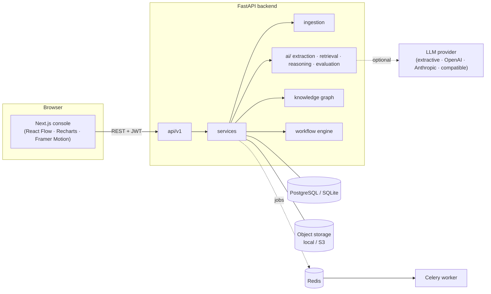
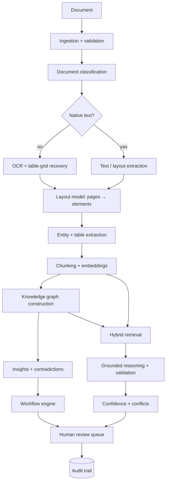

# NeuroForge AI

**Multimodal document intelligence and decision automation — every important AI conclusion is traceable to evidence.**

NeuroForge ingests contracts, invoices, scans, reports and spreadsheets; classifies them, extracts layout, tables, entities and
a knowledge graph; retrieves evidence with hybrid search and reranking; reasons over it with a provider-agnostic LLM layer
whose output is *validated against the cited sources*; detects contradictions across documents; routes risky findings to a
human review queue through user-defined workflows; and records a hash-chained audit trail that lets an auditor reconstruct
how any conclusion was reached.

It is not a PDF chatbot. When the evidence does not support an answer, it refuses.

## Contents

[Overview](#overview) · [Problem statement](#problem-statement) · [Architecture](#architecture) · [AI pipeline](#ai-pipeline) ·
[Multimodal processing](#multimodal-processing) · [Hybrid retrieval](#hybrid-retrieval) · [Knowledge graph](#knowledge-graph) ·
[Reasoning architecture](#reasoning-architecture) · [Evidence system](#evidence-system) · [Confidence engine](#confidence-engine) ·
[Human-in-the-loop](#human-in-the-loop) · [Workflow engine](#workflow-engine) · [Evaluation](#evaluation) · [Security](#security) ·
[Tech stack](#tech-stack) · [Folder structure](#folder-structure) · [Installation](#installation) · [Environment variables](#environment-variables) ·
[Docker](#docker) · [API documentation](#api-documentation) · [Testing](#testing) · [Deployment](#deployment) ·
[Limitations](#limitations) · [Future research](#future-research)

## Overview

| Capability | What it does | Where |
|---|---|---|
| Ingestion | Validated upload → async job → `QUEUED → PROCESSING → INDEXING → READY / FAILED` | `ingestion/`, `services/document_service.py`, `workers/` |
| Classification | Content-based (Contract, Invoice, Research Paper, Financial Report, Technical Documentation, Policy, Resume, Legal Document, General Report, Unknown) | `ai/extraction/classifier.py` |
| OCR + layout | OCR decided per page; headings, paragraphs, lists, tables, figures, headers/footers with bounding boxes and section paths | `ingestion/` |
| Entities + graph | 11 entity types, typed relationships, evidence on every edge, multi-hop traversal | `ai/extraction/`, `knowledge/` |
| Hybrid retrieval | semantic + BM25 + metadata + graph → 7-feature reranker | `ai/retrieval/` |
| Grounded reasoning | evidence-only generation; unsupported claims and fabricated citations removed; refusal | `ai/reasoning/` |
| Contradictions | typed-fact comparison across documents, never silently resolved | `ai/reasoning/contradiction.py` |
| Confidence | engineering index with documented components | `ai/reasoning/confidence.py` |
| Review + workflows | approve / reject / modify / escalate / request evidence; IF-THEN rules | `services/review_service.py`, `workflows/` |
| Comparison | semantic clause alignment, typed change detection | `services/comparison_service.py` |
| Audit | append-only, hash-chained, verifiable | `services/audit_service.py` |

## Problem statement

Organisations hold decisions in unstructured documents. Chat-over-PDF tools return fluent answers with no way to check them,
cannot notice that two documents disagree, and leave no record an auditor can rely on. NeuroForge treats *evidence* as the
unit of truth: facts are extracted deterministically with provenance, retrieval returns scored passages with page-level
locations, generation is checked claim-by-claim against those passages, disagreements are surfaced, and humans make the
consequential decisions.

## Architecture



Details and layering rules: [docs/architecture.md](docs/architecture.md).

## AI pipeline



## Multimodal processing

Text (headings, paragraphs, lists, metadata), **tables** (header detection, typed columns, cell relationships, total
reconciliation), **images/figures** (embedded images, vector charts, captions), **scanned PDFs** (OCR chosen automatically per
page; RapidOCR or Tesseract; deskew/denoise; ruled-table recovery), spreadsheets, DOCX, plain text and Markdown.
Every element keeps page number, bounding box (where available), source document, section path and type —
[docs/ingestion.md](docs/ingestion.md).

## Hybrid retrieval

Semantic embeddings, BM25, metadata filters (document, page, type, date, entity, section, chunk type) and knowledge-graph
expansion feed a reranker scoring semantic similarity, lexical relevance, metadata relevance, entity overlap, graph
relevance, recency and source quality. Results expose per-feature scores — [docs/retrieval.md](docs/retrieval.md).

## Knowledge graph

Entities and relationships with source evidence, entity/relationship lookup, multi-hop traversal, path tracing, an interactive
explorer where every edge opens the sentence and page it came from — [docs/knowledge-graph.md](docs/knowledge-graph.md).

## Reasoning architecture

Provider abstraction (`LLM_PROVIDER`, `LLM_MODEL`, `LLM_API_KEY`) with a local deterministic default; versioned prompts;
**post-generation validation** that strips fabricated citations, drops unsupported numbers/claims and refuses when nothing is
supported; contradiction detection; per-finding confidence — [docs/reasoning.md](docs/reasoning.md).

## Evidence system

```json
{ "document_id": 6, "page_number": 1, "section": "Agreement > 1. Term and Termination",
  "text": "…expires on June 30, 2027.", "relevance_score": 0.74, "retrieval_method": "lexical+semantic",
  "source_location": { "chunk_id": 12, "bbox": [56, 301, 539, 352] } }
```

Answers cite `[document - Page N]`. Clicking a citation opens the document viewer on that page with the passage's bounding
box highlighted.

## Confidence engine

`score = (0.25·retrieval + 0.15·quantity + 0.20·agreement + 0.15·source reliability + 0.25·model certainty) · (1 − contradiction penalty)`.
HIGH ≥ 0.75, MEDIUM ≥ 0.50, LOW below. **This is an engineering confidence index, not a calibrated probability**; the
disclaimer is returned with every score.

## Human-in-the-loop

Review tasks carry type, priority, AI recommendation, evidence, confidence, reviewer, status and audit history. Actions:
**approve, reject, modify, escalate, request more evidence** (which runs additional retrieval and attaches new evidence).
Decisions are final, attributed, update the underlying insight/contradiction, and are audited.

## Workflow engine

```text
IF   insight.severity_score >= 0.7  AND  insight.confidence >= 0.5
THEN create_review_task
```

Triggers: `document_ready`, `insight_created`, `contradiction_detected`, `manual`. Conditions: nested all/any over a
validated field set. Actions: `create_review_task`, `flag_document`, `set_insight_status`, `add_audit_note`. Every evaluation
stores a trace (field, operator, expected, actual, passed). Four default workflows are seeded.

## Evaluation

`make eval` ingests the sample corpus into an isolated database and measures Recall@K, Precision@K, MRR, nDCG, retrieval
ablations, citation coverage, groundedness, answer relevance (including must-refuse cases), classification
precision/recall/F1 and contradiction recall/precision. Results and caveats: [docs/evaluation.md](docs/evaluation.md).

## Security

JWT auth with four roles, upload validation (extension + magic bytes + size + names + path confinement), validated inputs,
CORS allow-list, secrets only from the environment, secret-redacting logs, production start-up guards, hash-chained audit
log — [docs/security.md](docs/security.md).

## Tech stack

| Area | Choice |
|---|---|
| API | FastAPI, Pydantic v2, SQLAlchemy 2, Alembic |
| Data | PostgreSQL (SQLite for local), Redis, Celery, S3-compatible storage |
| Documents | PyMuPDF, OpenCV, RapidOCR (ONNX) / Tesseract, pandas, openpyxl, python-docx |
| NLP / retrieval | spaCy, scikit-learn (feature hashing), own BM25, NumPy exact vector index, NetworkX; optional sentence-transformers |
| Frontend | Next.js 14, TypeScript, Tailwind CSS, shadcn-style Radix primitives, Framer Motion, Lucide, Recharts, React Flow |

## Folder structure

```text
Neuroforage-AI/            (repository root)
├── README.md  LICENSE  Makefile  pyproject.toml  alembic.ini  docker-compose.yml  .env.example
├── docs/                architecture · ingestion · retrieval · knowledge-graph · reasoning · evaluation · security · deployment · decisions/
├── backend/
│   ├── app/
│   │   ├── main.py  core/ (config, logging, security, exceptions)
│   │   ├── api/v1/  documents search knowledge insights review workflows comparison audit auth system
│   │   ├── db/      session, base, models/ (users, documents, knowledge, reasoning, review, workflow, audit)
│   │   ├── schemas/ requests, serializers, evidence
│   │   ├── services/  document search reasoning knowledge insight review workflow comparison audit stats
│   │   ├── ai/      providers/ embeddings/ retrieval/ extraction/ reasoning/ evaluation/
│   │   ├── ingestion/ pipeline pdf ocr images tables layout chunking formats
│   │   ├── knowledge/ graph builder traversal
│   │   ├── workflows/ engine conditions actions
│   │   ├── workers/   celery_app ingestion_tasks embedding_tasks analysis_tasks
│   │   └── utils/     hashing storage text
│   ├── migrations/  scripts/  tests/{unit,integration,api}
├── frontend/        app/ (routes) · components/ · lib/
├── data/            sample/ eval/ processed/
├── storage/         documents/ artifacts/
└── deployment/      Dockerfile.backend  Dockerfile.frontend  nginx.conf
```

Frontend routes: `/` landing · `/login` · `/dashboard` · `/documents` · `/documents/[id]` · `/search` · `/knowledge` · `/compare` ·
`/insights` · `/review` · `/workflows` · `/audit` (authenticated routes live in the `(console)` route group, which does not
change URLs).

## Installation

Prerequisites: Python 3.10+, Node 18+ (20 recommended). No database or Redis is needed for local runs.

```bash
git clone https://github.com/Yog-esh06/Neuroforage-AI.git && cd Neuroforage-AI

# backend
python -m venv .venv
.venv/Scripts/python -m pip install -e ".[dev]"        # macOS/Linux: .venv/bin/python
.venv/Scripts/python -m spacy download en_core_web_sm  # optional: statistical NER
cp .env.example .env                                   # edit secrets
.venv/Scripts/python backend/scripts/generate_sample_data.py
cd backend && ../.venv/Scripts/python -m uvicorn app.main:app --port 8000

# frontend (second terminal)
cd frontend && npm install && npm run dev              # http://localhost:3000
```

Sign in with `SEED_ADMIN_EMAIL` / `SEED_ADMIN_PASSWORD`. Upload `data/sample/*` from **Documents**.

## Environment variables

| Variable | Default | Purpose |
|---|---|---|
| `APP_ENV` | `development` | `production` disables auto table creation and enforces secure config |
| `DATABASE_URL` | SQLite file | `postgresql+psycopg2://…` in Docker/production |
| `JOB_BACKEND` | `inline` | `inline` (thread pool), `celery` (Redis workers), `sync` (tests) |
| `REDIS_URL` | `redis://localhost:6379/0` | Celery broker/backend |
| `STORAGE_BACKEND`, `STORAGE_DIR`, `S3_*` | `local` | object storage |
| `MAX_UPLOAD_MB`, `MAX_PAGES` | `50`, `500` | upload limits |
| `AUTH_ENABLED`, `JWT_SECRET`, `JWT_EXPIRE_MINUTES` | `true` | authentication |
| `SEED_ADMIN_EMAIL`, `SEED_ADMIN_PASSWORD`, `SEED_ADMIN_NAME` | see `.env.example` | first admin |
| `LLM_PROVIDER`, `LLM_MODEL`, `LLM_API_KEY`, `LLM_BASE_URL` | `extractive` | reasoning provider (server-side only) |
| `EMBEDDING_BACKEND`, `EMBEDDING_MODEL`, `EMBEDDING_DIM` | `hashing` | `sbert` for dense embeddings |
| `OCR_ENGINE`, `OCR_MIN_CHARS_PER_PAGE` | `auto`, `40` | OCR selection / trigger |
| `CORS_ORIGINS` | `http://localhost:3000` | allowed browser origins |
| `NEXT_PUBLIC_API_URL` | `http://localhost:8000` | frontend → API base URL |

## Docker

```bash
cp .env.example .env
docker compose up --build        # frontend :3000 · backend :8000 · postgres · redis · worker
```

## API documentation

Interactive OpenAPI: `http://localhost:8000/docs`. All routes are under `/api/v1`.

| Area | Endpoints |
|---|---|
| Auth | `POST /auth/login` · `GET /auth/me` · `POST /auth/register` (admin) |
| Documents | `POST /documents` · `GET /documents` · `GET /documents/{id}` · `…/pages[/{n}[/image]]` · `…/entities` · `…/tables` · `…/insights` · `…/file` · `POST …/reprocess` · `POST …/versions` · `DELETE` |
| Search | `POST /search` (hybrid) · `POST /search/ask` (grounded) · `GET /search/answers/{id}` |
| Knowledge | `GET /knowledge/entities` · `…/entities/{id}` · `…/entities/{id}/graph` · `…/overview` · `…/paths` · `…/stats` |
| Insights | `GET /insights` · `PATCH /insights/{id}/status` · `GET /insights/contradictions` · `PATCH …/contradictions/{id}` · `POST /insights/analyze/{doc}` |
| Review | `GET /review/tasks` · `GET /review/tasks/{id}` · `POST /review/tasks/{id}/action` |
| Workflows | `GET/POST /workflows` · `PATCH/DELETE /workflows/{id}` · `POST …/run` · `GET /workflows/runs` · `GET /workflows/meta` |
| Compare | `POST /compare` |
| Audit | `GET /audit` · `GET /audit/{id}` · `GET /audit/verify` · `GET /audit/actions` |
| System | `GET /health` · `GET /stats/dashboard` |

Errors share one envelope: `{"error": {"code", "message", "details"}}`.

## Testing

```bash
make test          # or: .venv/Scripts/python -m pytest
make test-fast     # skips OCR / full-pipeline tests
make eval          # evaluation framework
```

Unit: ingestion (valid / corrupted / truncated / blank / scanned / large PDFs, type sniffing, path traversal), grounded
generation (fabricated citations, unsupported values, refusal, fallback), contradictions, confidence, classification,
entity/relationship extraction, risk rules, reranking. Integration: the real sample corpus end-to-end (retrieval
strategies, filters, graph traversal, insights, contradictions, answers, workflows, review, comparison, dashboard truthfulness,
audit-chain tamper detection). API: authentication, authorization, validation, 404s, upload security, CORS, secret leakage.

### Verification scripts (no Docker or Redis required)

| Command | What it proves |
|---|---|
| `make verify-postgres` | starts a real embedded PostgreSQL 16 (`pip install -e ".[verify]"`), applies the Alembic migration, checks there is no model/migration drift, and runs the API + integration suite against it |
| `make verify-worker` | an upload is accepted by the API and consumed by a **separate Celery worker process** (filesystem broker; on Windows `pywin32` is installed with the `dev` extra) |
| `make eval` | quality metrics on the labelled corpus ([docs/evaluation.md](docs/evaluation.md)) |

### What has and has not been verified in this repository

Verified by running it: the backend (93 tests on SQLite; API + integration suite on PostgreSQL 16), the Alembic migration, the
async ingestion lifecycle through the HTTP API, OCR on a rotated noisy scan, a real Celery worker consuming a job, the
production Next.js build and TypeScript check, and every console page rendered in headless Chrome against live data.
**Not verified** (no Docker daemon or Redis server was available on the development machine): `docker compose up --build`,
the two Dockerfiles, the nginx profile, and Celery against a real Redis broker. The compose file is syntactically valid and its
service wiring was checked, but treat the first `docker compose up` on your machine as the real test.

## Deployment

Vercel (frontend), Render / Railway / AWS / Azure (backend), managed PostgreSQL, S3-compatible storage —
[docs/deployment.md](docs/deployment.md).

## Limitations

* **Embeddings:** the default encoder is a hashing/concept encoder, not a neural model; enable `sbert` for dense semantics.
* **Extraction recall** is bounded by the rule tables; no coreference resolution beyond contract references; no
  dependency-parse relations. Borderless scanned tables are not reconstructed.
* **Contradiction detection** covers a fixed set of fact types (dates, amounts, durations, rates, governing law, auto-renewal,
  revenue/income/EBITDA, headcount), not arbitrary semantic conflicts.
* **Grounding validation** uses lexical support as a proxy for entailment; heavy paraphrase can be dropped.
* **Confidence** is an engineering index, uncalibrated.
* **Scale:** exact in-memory vector index and per-process caches (see architecture.md).
* **Security:** JWT in `localStorage`, no rate limiting/MFA/document-level ACLs (see security.md).
* **Evaluation** runs on a small synthetic corpus; scores are indicative, not benchmarks.

## Future research

Calibrated confidence from reviewer outcomes; NLI-based claim verification; learned reranker (LTR) trained on review
feedback; table-structure recognition models for borderless scans; layout-aware multimodal encoders; relation extraction with
dependency parses or a fine-tuned extractor validated against the rule baseline; incremental fact tables for large-scale
contradiction detection; pgvector/FAISS-HNSW indexing; document-level access control and external audit anchoring.
