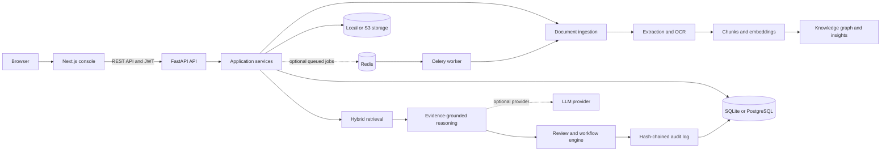
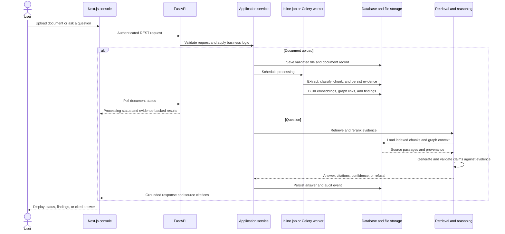

# NeuroForge AI

### Evidence-grounded document intelligence and decision support for complex business records.

[](https://www.python.org/)
[](https://fastapi.tiangolo.com/)
[](https://nextjs.org/)
[](LICENSE)

NeuroForge AI ingests business documents, extracts structured content and evidence, and makes that information searchable through a web console and API. Its hybrid retrieval, evidence-checked answers, contradiction detection, human review workflows, and hash-chained audit trail are designed to make findings traceable to their source.

> **Notice:** NeuroForge AI is an experimental prototype, not a certified compliance, legal, financial, or records-management system. Validate findings against original documents and qualified reviewers before making consequential decisions.

## Contents

- [What the project delivers](#what-the-project-delivers)
- [Quick start](#quick-start)
- [System architecture](#system-architecture)
- [Scientific design / Methodology](#scientific-design--methodology)
- [Installation and operation](#installation-and-operation)
- [Repository structure](#repository-structure)
- [License](#license)

## What the project delivers

| Capability | Implementation |
|---|---|
| Multiformat ingestion | Validates and processes PDF, images, text, Markdown, CSV, Excel, and DOCX files. Extracts page layout, tables, and OCR text where needed. |
| Document understanding | Content-based document classification, deterministic entity and relationship extraction, chunking, and provenance linking. |
| Hybrid evidence retrieval | Combines dense or hashing-based semantic search, BM25 lexical search, metadata filters, and knowledge-graph expansion with a feature-based reranker. |
| Grounded question answering | Retrieves source passages, generates an answer using the configured provider, validates claims and citations against evidence, and refuses unsupported answers. |
| Knowledge graph and insights | Builds evidence-linked entity relationships and detects selected risks, table-total discrepancies, and cross-document contradictions. |
| Human review and workflows | Routes selected findings for review and supports configurable rules and actions, with decisions recorded for audit. |
| Web console and API | Next.js interface for documents, search, knowledge, insights, review, workflows, comparisons, and audit; FastAPI endpoints are under `/api/v1`. |
| Evaluation | Provides a sample-corpus evaluation runner for retrieval, answer grounding, classification, and contradiction metrics. |

## Quick start

Prerequisites: Python 3.10 or later, Node.js 18 or later, and npm. Docker, PostgreSQL, and Redis are not required for a basic local run.

```powershell
python -m venv .venv
.\.venv\Scripts\python.exe -m pip install -e ".[dev]"
Copy-Item .env.example .env
```

In a terminal at the repository root, start the API:

```powershell
.\.venv\Scripts\python.exe -m uvicorn app.main:app --reload --port 8000 --app-dir backend
```

In a second terminal, start the frontend:

```powershell
Set-Location frontend
npm install
npm run dev
```

Open [http://localhost:3000](http://localhost:3000). The local configuration uses SQLite, inline background jobs, local file storage, and the extractive answer provider. The seeded administrator credentials are controlled by `SEED_ADMIN_EMAIL` and `SEED_ADMIN_PASSWORD` in `.env`; change them before exposing the application.

## System architecture

NeuroForge is structured as a modular backend with a separate web console. In local development the API can process jobs inline; a deployment can use Celery workers backed by Redis.





## Scientific design / Methodology

Processing combines deterministic rules with optional statistical or language-model components. Upload validation and file-type detection precede extraction. Native PDF text is preferred; OCR is selected per page when text is missing or insufficient. The pipeline extracts layout and tables from supported document formats, classifies content, identifies entities and typed relationships, then creates page- and section-aware chunks with source locations.

Search combines semantic similarity, BM25, metadata signals, and graph expansion. The default `hashing` embedding backend is deterministic feature hashing with curated concept features; it is not a neural embedding model. The optional `sbert` backend uses sentence-transformers. A feature-based reranker combines candidate scores and exposes them for inspection.

Answer generation receives retrieved evidence and must cite it. Post-generation validation removes invalid citations and unsupported claims, including unsupported numeric values; if no supported answer remains, the system refuses. The default `extractive` provider creates deterministic answers from evidence without an external API key. Confidence scores are engineering indices, not calibrated probabilities. Extraction, contradiction detection, and grounding each have documented coverage and limitations; see the [architecture](docs/architecture.md), [ingestion](docs/ingestion.md), [retrieval](docs/retrieval.md), [reasoning](docs/reasoning.md), and [evaluation](docs/evaluation.md) documentation.

## Installation and operation

### Local development

1. Install Python 3.10+ and Node.js 18+.
2. Create and activate a virtual environment, then install the backend and development dependencies:

   ```powershell
   python -m venv .venv
   .\.venv\Scripts\Activate.ps1
   python -m pip install -e ".[dev]"
   ```

   On macOS or Linux, activate with `source .venv/bin/activate`.
3. Copy `.env.example` to `.env` and adjust the settings you need. Optionally install the spaCy English model for statistical NER:

   ```powershell
   python -m spacy download en_core_web_sm
   ```

4. Run the API from the repository root:

   ```powershell
   python -m uvicorn app.main:app --reload --port 8000 --app-dir backend
   ```

5. In another terminal, install and run the frontend:

   ```powershell
   Set-Location frontend
   npm install
   npm run dev
   ```

6. Visit [http://localhost:3000](http://localhost:3000). The API's interactive documentation is at [http://localhost:8000/docs](http://localhost:8000/docs). Generate sample documents with `python backend/scripts/generate_sample_data.py`.

### Configuration

Settings are read from environment variables and the root `.env` file. The defaults below are suitable only for local development. Do not deploy with the example credentials or placeholder JWT secret.

| Variable | Default | Purpose |
|---|---|---|
| `APP_ENV` | `development` | In `production`, requires safer auth configuration and disables automatic table creation; apply Alembic migrations. |
| `DATABASE_URL` | SQLite | Database connection; Docker Compose configures PostgreSQL. |
| `JOB_BACKEND` | `inline` | Run jobs inline locally or set to `celery` for queued worker jobs. |
| `REDIS_URL` | `redis://localhost:6379/0` | Celery broker when `JOB_BACKEND=celery`. |
| `STORAGE_BACKEND`, `STORAGE_DIR` | `local` | Select local document storage or S3-compatible storage. |
| `S3_BUCKET`, `S3_ENDPOINT_URL`, `S3_REGION`, `S3_ACCESS_KEY_ID`, `S3_SECRET_ACCESS_KEY` | Empty/default region | S3-compatible storage settings when `STORAGE_BACKEND=s3`. |
| `AUTH_ENABLED` | `true` | Enable authentication. Keep enabled in production. |
| `JWT_SECRET` | Development placeholder | Signing secret; set a strong secret in production. |
| `SEED_ADMIN_EMAIL`, `SEED_ADMIN_PASSWORD`, `SEED_ADMIN_NAME` | Local administrator defaults | Initial administrator account; replace the password before deployment. |
| `CORS_ORIGINS` | `http://localhost:3000` | Comma-separated allowed browser origins. |
| `LLM_PROVIDER` | `extractive` | `extractive`, `openai`, `anthropic`, or `openai_compatible`. |
| `LLM_MODEL`, `LLM_API_KEY`, `LLM_BASE_URL` | Empty | Provider model and server-side credentials/URL where applicable. |
| `EMBEDDING_BACKEND` | `hashing` | Set to `sbert` to use sentence-transformers; install with `pip install -e ".[sbert]"`. |
| `OCR_ENGINE`, `OCR_MIN_CHARS_PER_PAGE` | `auto`, `40` | OCR selection and native-text threshold. |
| `MAX_UPLOAD_MB`, `MAX_PAGES` | `50`, `500` | Upload and document page limits. |
| `NEXT_PUBLIC_API_URL` | `http://localhost:8000` | API base URL used by the frontend. |

### Docker Compose

For the multi-service setup with PostgreSQL, Redis, a Celery worker, and the web console:

```powershell
Copy-Item .env.example .env
docker compose up --build
```

The console is served on port 3000 and the API on port 8000. The optional Nginx proxy can be started with the `proxy` profile. See [deployment documentation](docs/deployment.md) for production configuration, migrations, and storage options.

### Tests and evaluation

Install the `dev` extra, then run:

```powershell
python -m pytest
python -m pytest -m "not slow"
```

Use `make eval` to run the evaluation framework. The Makefile commands expect GNU Make; on Windows, run the corresponding Python/npm commands directly or use a compatible Make environment.

## Repository structure

```text
Neuroforage-AI/
├── README.md
├── LICENSE
├── Makefile
├── alembic.ini
├── docker-compose.yml
├── pyproject.toml
├── .env.example
├── backend/
│   ├── app/
│   │   ├── main.py
│   │   ├── ai/
│   │   │   ├── embeddings/
│   │   │   ├── evaluation/
│   │   │   ├── extraction/
│   │   │   ├── providers/
│   │   │   ├── reasoning/
│   │   │   └── retrieval/
│   │   ├── api/v1/
│   │   ├── core/
│   │   ├── db/
│   │   ├── ingestion/
│   │   ├── knowledge/
│   │   ├── schemas/
│   │   ├── services/
│   │   ├── utils/
│   │   ├── workers/
│   │   └── workflows/
│   ├── migrations/
│   ├── scripts/
│   └── tests/
│       ├── api/
│       ├── integration/
│       └── unit/
├── data/
│   ├── eval/
│   ├── processed/
│   └── sample/
├── deployment/
│   ├── Dockerfile.backend
│   ├── Dockerfile.frontend
│   └── nginx.conf
├── docs/
│   ├── decisions/
│   ├── architecture.md
│   ├── deployment.md
│   ├── evaluation.md
│   ├── ingestion.md
│   ├── knowledge-graph.md
│   ├── reasoning.md
│   ├── retrieval.md
│   └── security.md
├── frontend/
│   ├── app/
│   ├── components/
│   └── lib/
└── storage/
    ├── artifacts/
    └── documents/
```

## License

MIT License

Copyright (c) 2026 NeuroForge AI contributors

Permission is hereby granted, free of charge, to any person obtaining a copy
of this software and associated documentation files (the "Software"), to deal
in the Software without restriction, including without limitation the rights
to use, copy, modify, merge, publish, distribute, sublicense, and/or sell
copies of the Software, and to permit persons to whom the Software is
furnished to do so, subject to the following conditions:

The above copyright notice and this permission notice shall be included in all
copies or substantial portions of the Software.

THE SOFTWARE IS PROVIDED "AS IS", WITHOUT WARRANTY OF ANY KIND, EXPRESS OR
IMPLIED, INCLUDING BUT NOT LIMITED TO THE WARRANTIES OF MERCHANTABILITY,
FITNESS FOR A PARTICULAR PURPOSE AND NONINFRINGEMENT. IN NO EVENT SHALL THE
AUTHORS OR COPYRIGHT HOLDERS BE LIABLE FOR ANY CLAIM, DAMAGES OR OTHER
LIABILITY, WHETHER IN AN ACTION OF CONTRACT, TORT OR OTHERWISE, ARISING FROM,
OUT OF OR IN CONNECTION WITH THE SOFTWARE OR THE USE OR OTHER DEALINGS IN THE
SOFTWARE.

<p align="center"><strong>NeuroForge AI</strong><br>Evidence-grounded intelligence for documents and decisions.</p>
