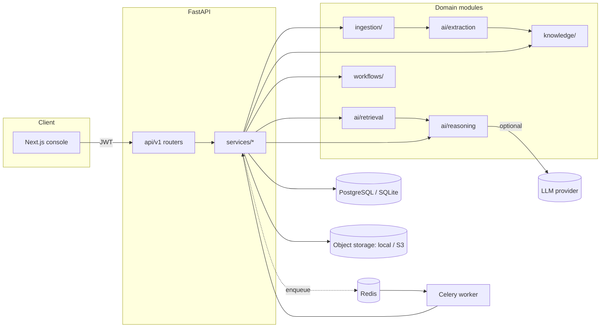
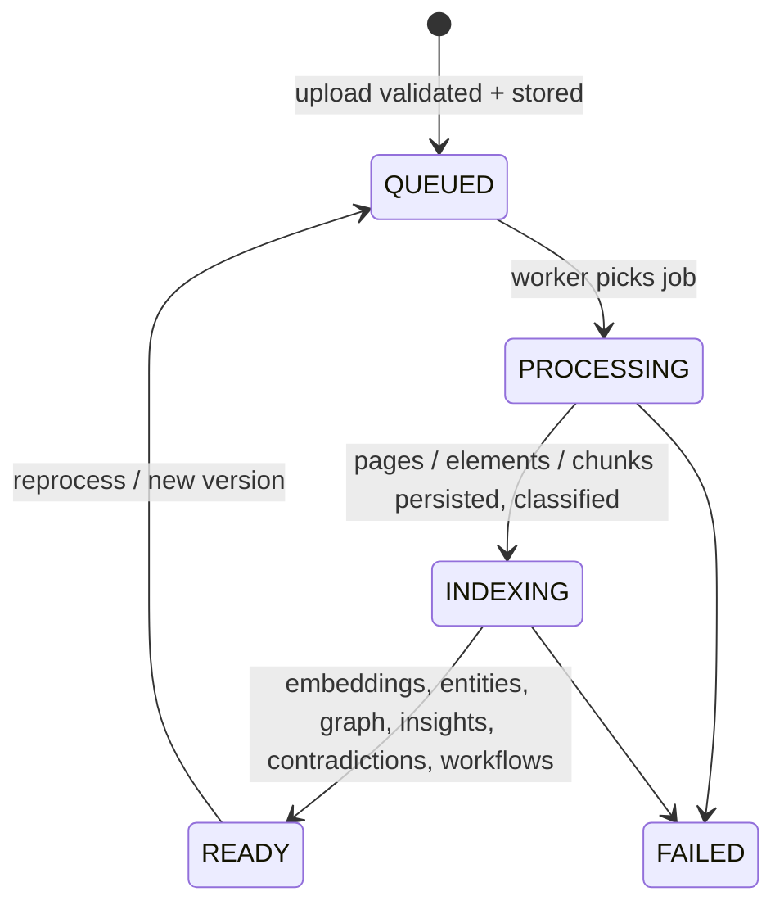
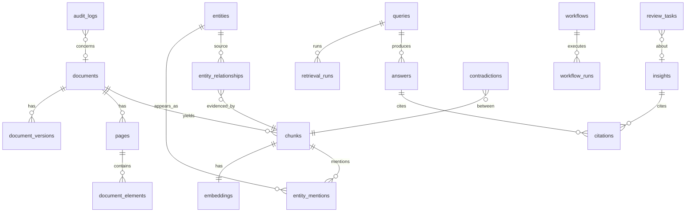

# Architecture

NeuroForge is a modular monolith: one FastAPI service, one worker pool (the same code), a relational store, and a Next.js
console. Boundaries are enforced by package layout, not by network hops, because the interesting complexity is in the AI
pipeline rather than in service orchestration.

## Layering rules

| Layer | Responsibility | May import |
|---|---|---|
| `api/v1/*` | HTTP shape, auth dependency, input validation | `services`, `schemas`, `core` |
| `services/*` | Application logic: transactions, audit, orchestration | `ai`, `ingestion`, `knowledge`, `workflows`, `db` |
| `ai/*`, `ingestion/`, `knowledge/`, `workflows/` | Pure domain logic; no HTTP | `db` (models), `utils` |
| `db/` | SQLAlchemy models, sessions | — |

API modules contain no business logic; every router function is a thin call into a service.

## Document lifecycle

`processing_jobs` records the stage, progress, attempts and per-stage timings (extract, chunk, embed, knowledge, analysis).
The frontend polls `GET /documents` while any document is in flight.

## Data model (traceability)

Every AI-generated artifact (`insights`, `answers`, `contradictions`, `entity_relationships`, `review_tasks`) points back to
`documents` and, where possible, to the exact `chunks` (page, section, bbox). `audit_logs` is append-only and hash-chained.

## Concurrency model

* API requests are synchronous endpoints run in FastAPI's threadpool; each opens its own SQLAlchemy session.
* Ingestion runs in a worker (`JOB_BACKEND=celery`) or an in-process 2-thread pool (`inline`, default for local runs) or
  synchronously (`sync`, tests). The code path is identical (`document_service.process_document`).
* In-memory retrieval structures (chunk metadata cache, BM25 index, vector matrix, NetworkX graph) are rebuilt lazily after
  `index_registry.invalidate_all()`. In a multi-process deployment each process rebuilds on its next read after an
  ingestion completes in another process; see *Scaling limits* below.

## Scaling limits (honest)

* The vector index is exact brute-force cosine in memory (fine to ~10⁵ chunks). `ai/embeddings/index.py` is the single
  seam to replace with FAISS/pgvector.
* BM25, the chunk cache and the graph are per-process memory. With several API replicas the caches are rebuilt per
  replica; a shared index service (OpenSearch/pgvector) is the natural next step.
* Cross-document contradiction scanning is O(sentences) per ingestion over the whole corpus; it would need a fact table
  keyed by topic to scale to very large corpora.
