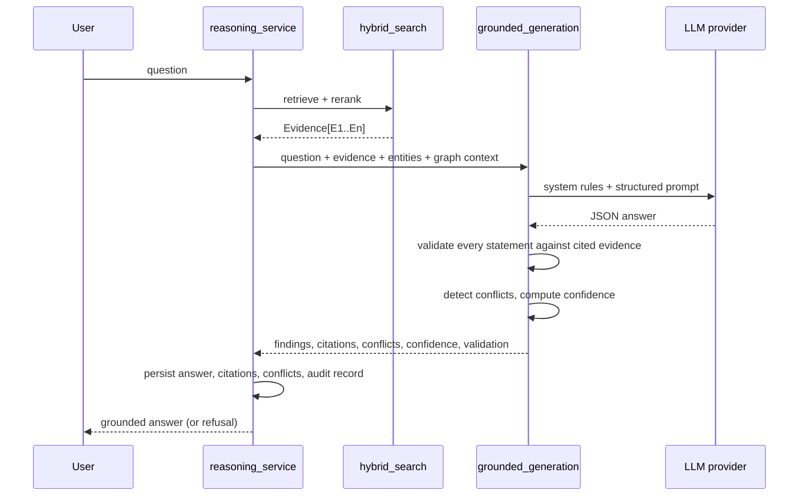

# Reasoning, grounding, contradictions and confidence

Code: `ai/providers/`, `ai/reasoning/`, `services/reasoning_service.py`, `services/insight_service.py`.

## Provider abstraction

`LLM_PROVIDER`, `LLM_MODEL`, `LLM_API_KEY`, `LLM_BASE_URL` select the provider (`provider_factory.py`):

| `LLM_PROVIDER` | Behaviour |
|---|---|
| `extractive` (default) | Local, deterministic, no key. Builds findings from **verbatim evidence sentences**; risk questions use the shared risk rules. No paraphrase, no inference. |
| `openai` | OpenAI Chat Completions (JSON mode) |
| `openai_compatible` | Any OpenAI-compatible server (`LLM_BASE_URL`): Ollama, vLLM, LM Studio… |
| `anthropic` | Anthropic Messages API |

If a provider is selected but unusable (missing key/URL) the factory logs a warning and uses `extractive`. Provider errors
and invalid JSON at runtime fall back to the extractive composer and are recorded in `validation.fallback`. Keys are read
from the server environment only; error messages never echo request bodies or headers.

## What the model receives

User question, numbered evidence (`E1…`, with document, page, section, text), extracted entities, knowledge-graph
relationships touching the evidence, and the versioned system prompt (`PROMPT_VERSION = ng-grounded-v1`) that requires:
never invent evidence; separate **fact** from **inference**; state uncertainty; cite evidence ids; report contradictions;
refuse unsupported conclusions. Output is one JSON object (summary, findings → statements → evidence ids, entities,
reasoning, contradictory evidence, recommended action, uncertainty notes).

## Validation — the part that makes "never fabricate citations" true

Applied to **every** provider's output, after generation:

1. Cited ids must exist in the supplied evidence set; invalid ids are stripped and logged.
2. A statement with no valid citation is dropped.
3. Every number/amount/date in a statement must literally occur in the cited evidence (`values not in cited evidence` → drop).
4. The share of the statement's content terms found in the cited evidence must reach 0.55 (fact) / 0.35 (inference).
5. Summary sentences are filtered the same way against the whole evidence set.
6. If nothing survives, the answer is a **refusal** with the reason.

Citations in the response are built from the `Evidence` objects, never from model text. Dropped claims are reported in
`validation.unsupported_claims` and shown in the UI. Citation coverage and groundedness are re-computed independently by
the evaluation module.

## Contradiction detection (`contradiction.py`)

Sentences → typed **facts** `(topic, value, subject, qualifiers)` for: contract expiration, effective date, contract value,
liability cap, term length, notice period, payment terms, late-payment rate, revenue/net income/EBITDA, headcount,
governing law, automatic renewal. Facts with the same topic across documents are compared:

* qualifier sets must match (`annual fee` vs `monthly fee` is not a conflict);
* subjects must be compatible (a named contract/organisation overlap) — or sentence similarity must be higher when no
  subject is known;
* a date belongs to the nearest preceding date-topic trigger, so *"commences on the Effective Date and expires on June 30,
  2027"* yields an expiration, not an effective date;
* independent records (two invoices, two resumes) are not compared with each other;
* values must differ materially (dates at their coarsest shared precision, amounts beyond 0.5 %).

`confidence = clip(0.50 + subject agreement (≤0.20) + sentence similarity (≤0.20) + precision alignment (≤0.10), 0.30, 0.97)`;
only ≥ 0.55 is reported. Conflicts are stored once per (topic, document pair, values) in canonical order, surfaced in
answers (never silently resolved), on `/insights`, in the document viewer, and routed to review by a default workflow.

## Confidence engine (`confidence.py`)

An **engineering confidence index**, not a calibrated probability. `score = (Σ wᵢ·componentᵢ) · (1 − contradiction penalty)`:

| Component | Weight | Meaning |
|---|---|---|
| retrieval quality | 0.25 | mean of the top-3 reranked relevance scores (0.65 ⇒ 1.0) |
| evidence quantity | 0.15 | `1 − exp(−n/3)` + 0.08 per extra independent document |
| evidence agreement | 0.20 | corroboration (a near-identical sentence in ≥ 2 items/documents) blended with absence of conflicts |
| source reliability | 0.15 | mean source quality (native text > OCR confidence) |
| model certainty | 0.25 | groundedness × (1 − 0.12 per uncertainty note) |

Penalty: `min(0.5, 0.35·max conflict confidence + 0.05 per extra conflict)`, applied only to conflicts that touch the
statements being scored. Levels: HIGH ≥ 0.75, MEDIUM ≥ 0.50, LOW otherwise; zero evidence ⇒ 0.0. The disclaimer is returned
with every score. Calibrating against labelled outcomes would be required to read it as a probability.

## Insights (`insight_service.py`)

Per document, deterministic detectors (`risk_rules.py`: unlimited liability, indemnity, auto-renewal, termination for
convenience, penalties/liquidated damages, late-payment interest, exclusivity, IP assignment, data breach, regulatory
non-compliance, financial-distress language, vulnerabilities, unilateral change rights, material payment obligations,
short notice periods) plus **table-total reconciliation** and key terms for agreements. Rules respect negation
("no substantial doubt about our ability to continue as a going concern" is *not* flagged). Each insight stores evidence
(page, chunk, bbox), rule id, severity, a confidence from the same engine, and is audited. New insights/contradictions fire
the workflow engine.
