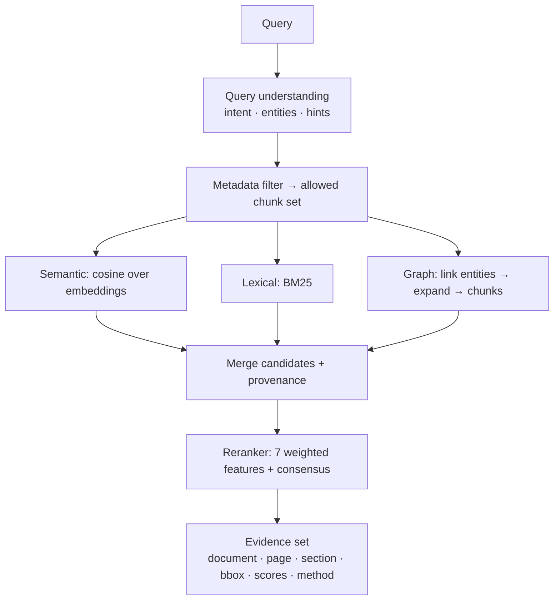

# Hybrid retrieval and reranking

Code: `backend/app/ai/retrieval/`, `ai/embeddings/`, orchestrated by `services/search_service.py`.



## Strategies

**Semantic.** `ai/embeddings/encoder.py` provides two encoders behind one interface:

* `hashing` (default, zero extra dependencies, deterministic): feature-hashed word uni/bi-grams (light stemming) + character
  4–5-grams + a curated concept lexicon (terminate/expire/end, fee/payment/price, risk/liability/penalty …). It is a
  *lexical-semantic-lite* encoder: it generalises across morphology, spelling and the curated groups. It is **not** a neural
  model and will miss paraphrases outside those groups.
* `sbert` (`EMBEDDING_BACKEND=sbert`, `pip install -e ".[sbert]"`): sentence-transformers dense embeddings. If the package is
  missing, the system logs a warning and falls back to `hashing`.

Vectors are persisted (`embeddings`, float32) with the model name; `ai/embeddings/index.py` is an exact in-memory cosine
index (the seam where FAISS/pgvector would plug in). `workers/embedding_tasks.reembed_all` regenerates vectors after a
model change.

**Lexical.** Own BM25 implementation (k1=1.5, b=0.75) over stemmed text *including the section heading*, restricted to the
allowed set.

**Metadata.** `MetadataFilter`: documents, document types, page range, upload date range, content dates (chunks that mention
a DATE entity in range), entities (chunk must mention all), section substring, chunk type (text/table).

**Graph.** Query entity linking (canonical-name phrase match) → breadth-first expansion (2 hops, weight 0.55^hop) →
chunks that mention reached entities, boosted when a relationship's own evidence chunk connects two reached entities.

## Query understanding

`query.py` extracts intents (risk, contradiction, date, money, obligation, definition, summary), entities, document-type
hints ("the contracts"), page hints ("page 12") and recency wording. Hints are **soft** — they feed the reranker's
metadata feature instead of hard-filtering, so a wrong guess cannot hide the right passage.

## Reranker (`reranker.py`)

```text
score = Σ wᵢ · featureᵢ  +  0.04 · (number of independent strategies that retrieved the chunk − 1)
```

| Feature | Definition | Default w |
|---|---|---|
| semantic | cosine relative to the best candidate, damped when the best match is itself weak | 0.30 |
| lexical | BM25 relative to the best candidate | 0.25 |
| metadata | doc-type hint, page hint, query terms in the section heading, risk-clause presence for risk questions | 0.07 |
| entity | share of query entities present in the chunk (graph-linked or textual) | 0.11 |
| graph | graph proximity score | 0.12 |
| recency | `exp(-ln2·age/365d)` relative to the newest document | 0.02 (0.12 if the query asks for "latest/current") |
| quality | source reliability: native text > OCR confidence; classification confidence | 0.07 |

Weights are normalised at runtime and can be overridden per request (`weights` in `POST /search`). They are engineering
defaults, not learned; `docs/evaluation.md` shows the ablation (semantic-only vs lexical-only vs graph-only vs hybrid).
Every evidence item returns its per-feature scores so rankings are explainable in the UI.

## Evidence object

```json
{ "evidence_id": "E1", "document_id": 6, "document_name": "msa.pdf", "document_type": "Contract",
  "page_number": 1, "section": "Agreement > 1. Term and Termination", "text": "…",
  "relevance_score": 0.74, "retrieval_method": "lexical+semantic",
  "source_location": { "chunk_id": 12, "bbox": [56, 301, 539, 352], "page_end": null },
  "features": { "semantic": 0.9, "lexical": 1.0, "metadata": 0.5, "entity": 0, "graph": 0, "recency": 1, "quality": 0.93 } }
```
